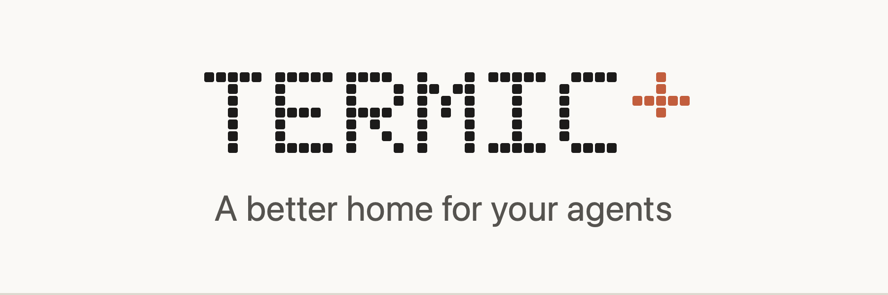

<div align="center">

<picture>
  <source media="(prefers-color-scheme: dark)" srcset="./docs/banner-dark.png">
  <source media="(prefers-color-scheme: light)" srcset="./docs/banner-light.png">
  
</picture>

[Build it](#build-it) · [What Termic+ adds](#what-termic-adds) · [Guides](./docs/guide/README.md) · [Contributing](./CONTRIBUTING.md)

</div>

Termic+ is my fork of [Termic](https://github.com/simion/termic) by Simion
Agavriloaei. Termic runs coding-agent CLIs (`claude`, `codex`, `gemini` and
others) side by side in one window, each in its own git worktree with its own
terminal. Everything upstream does still works here. The fork adds the
features below, which I wanted for my own daily use and which have not gone
upstream.

If you only want Termic itself, use upstream. It has signed releases, a
Homebrew cask and an auto-updater. Termic+ has none of those yet, so you build
it from source.

## What Termic+ adds

| Feature | In short | Guide |
| --- | --- | --- |
| Claude subagent view | Each subagent a `claude` tab starts gets its own sidebar row, and a click opens its live transcript | [Subagents](./docs/guide/subagents.md) |
| Keep agents running | Agents can live in a background process, so quitting or updating Termic no longer kills them | [Keep agents running](./docs/guide/keep-agents-running.md) |
| Interface redesign | A reworked sidebar, title bar, tab bar, footer and right panel | [Interface tour](./docs/guide/interface.md) |
| Rename, format and code actions | Language-server rename across files, format document and quick fixes in the editor | [Code intelligence](./docs/guide/code-intelligence.md) |
| File explorer | A filter over every file in the task, new file and folder buttons, pinned folders and keyboard navigation | [File explorer](./docs/guide/file-explorer.md) |
| Zed keymap | An opt-in editor preset with Zed's multi-cursor, selection and line keys | [Zed keymap](./docs/guide/zed-keymap.md) |
| Workspaces | How tasks, worktrees and profiles fit together, and how to use them | [Workspaces](./docs/guide/workspaces.md) |

## Build it

You need Rust, Node 20 or newer and the platform build tools. `make setup`
installs what is missing and `make doctor` checks without installing.

```sh
git clone https://github.com/stafawashere/termic.git termic-plus
cd termic-plus
make setup
make install
```

`make install` builds a release app and installs it into `/Applications` on
macOS (a per-user installer on Windows). `make dev` runs it with hot reload
instead. The build targets Linux and Windows too, but I only use and test the
fork on macOS.

Termic+ keeps the upstream bundle id, `com.simion.termic`, and the same data
directory. Installing it replaces an upstream Termic install and uses its
projects and settings as they are. On macOS those live in
`~/Library/Application Support/termic/`, so back that folder up first if you
want to go back and forth.

## Differences from upstream you will notice

- Find in files moved from `Shift+Cmd+F` to `Opt+Cmd+F`. `Shift+Cmd+F` now
  focuses the sidebar filter and `Shift+Cmd+E` focuses the file filter in the
  right panel.
- The editor has three new rebindable commands: Rename symbol (`F2`), Format
  document (`Shift+Alt+F`) and Code actions (`Cmd+.`).
- The sidebar can switch between the project tree and status buckets from its
  header.

Every new behavior is opt-in or off by default except the interface changes
and the shortcut move.

## Docs

The [guides](./docs/guide/README.md) are for people using the app. The rest of
`docs/` is reference material for working on the code, inherited from upstream
and kept current: [ui.md](./docs/ui.md), [shortcuts.md](./docs/shortcuts.md),
[themes.md](./docs/themes.md), [lsp.md](./docs/lsp.md),
[sandbox.md](./docs/sandbox.md) and others.

The banner at the top is drawn from `tools/banner/banner.html`.
`sh tools/banner/regenerate.sh` rebuilds both images (macOS only).

## Credit and license

Termic is written and maintained by Simion Agavriloaei at
[simion/termic](https://github.com/simion/termic). Almost all of this code is
his. Termic+ is distributed under the same license, the
[GNU AGPL 3.0](./LICENSE).
